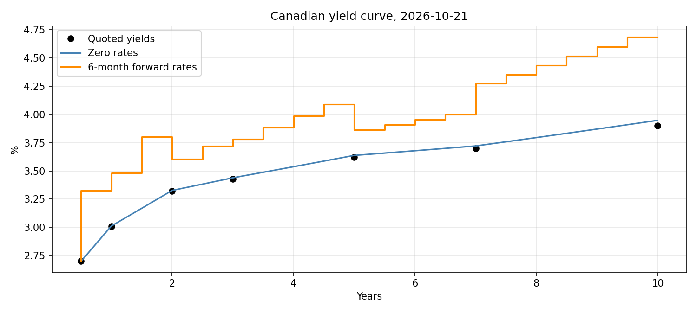
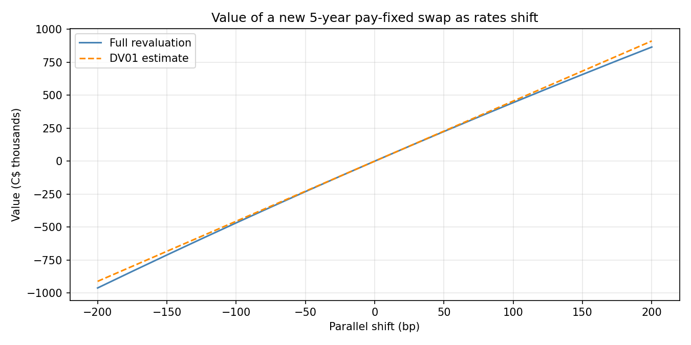

# Interest Rate Swap Valuation (Canadian Yield Curve)

Building a yield curve from public Bank of Canada data, valuing a plain vanilla interest rate
swap by discounting its fixed and floating legs, and measuring how the value moves when rates
move (DV01).

<p align="center">
  
</p>

---

## Overview

An interest rate swap exchanges fixed payments for floating ones on the same notional, and it is
one of the most common OTC derivatives. This project answers three simple questions:

1. What is the fair fixed rate on a new 5-year swap?
2. What is an existing swap worth after rates have moved?
3. How much does the value change for a small move in rates?

The swaps are hypothetical: C$10M notional, paying fixed and receiving floating.

---

## Data

| | |
|---|---|
| **Source** | Bank of Canada Valet API, downloaded when the notebook runs |
| **Instruments** | 6-month and 1-year T-bills; 2, 3, 5, 7 and 10-year benchmark bonds |
| **Dates** | October 21, 2026 (valuation) and October 22, 2025 (original swap) |

No data file is stored in the repo.

---

## Method

1. **Bootstrap** semi-annual discount factors from the yields, treating them as par yields.
2. **Value both legs**: fixed payments are known, and floating payments use forward rates from the curve.
3. **Check the results** with simple tests.
4. **Bump the curve** by 1bp, rebuild it and value the swap again to get DV01.

---

## Results

| Measure | Value |
|---|---|
| 5-year par rate | 3.62% |
| Value of a swap entered one year ago at 2.64% (4 years left) | about C$328,500 |
| DV01, new 5-year swap | about C$4,555 per 1bp |
| DV01, old swap | about C$3,640 per 1bp |
| DV01 estimate vs full revaluation at ±100bp | off by about C$12,000 (2.6%) |

**Checks that passed**

- Par bonds repriced to 100.0000 on the bootstrapped curve.
- A swap at the par rate was worth 0.00.
- The floating leg matched the shortcut, notional × (1 − final discount factor).
- The old swap's value matched the rate difference × annuity × notional.

<p align="center">
  
</p>

---

## Limitations

- This uses a government bond curve, not a swap curve. Real Canadian swaps float on CORRA and are
  discounted on a CORRA curve, so a dealer's quoted rate would be different.
- Both legs pay semi-annually with no day counts, which is simpler than a real CORRA swap.
- T-bill yields are treated as par yields, which is an approximation at the short end.
- Straight-line interpolation makes the forward rates jagged.
- There are no credit or collateral effects, and the old swap ignores accrued interest.

---

## How to run

```bash
pip install -r requirements.txt
jupyter notebook swap_valuation.ipynb
```
