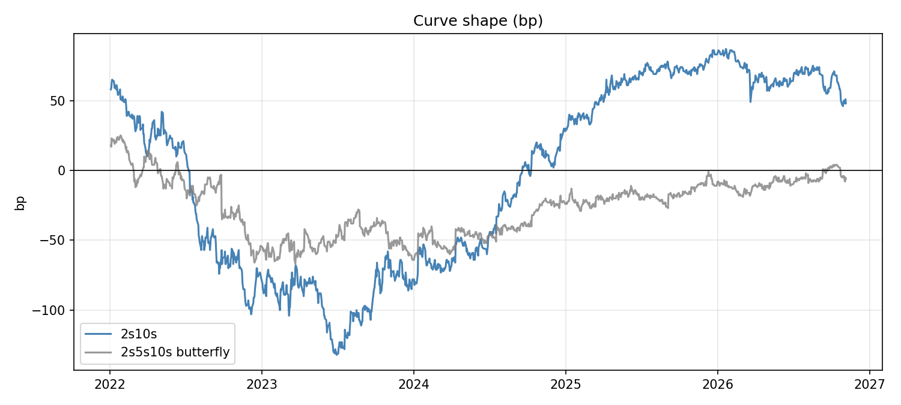
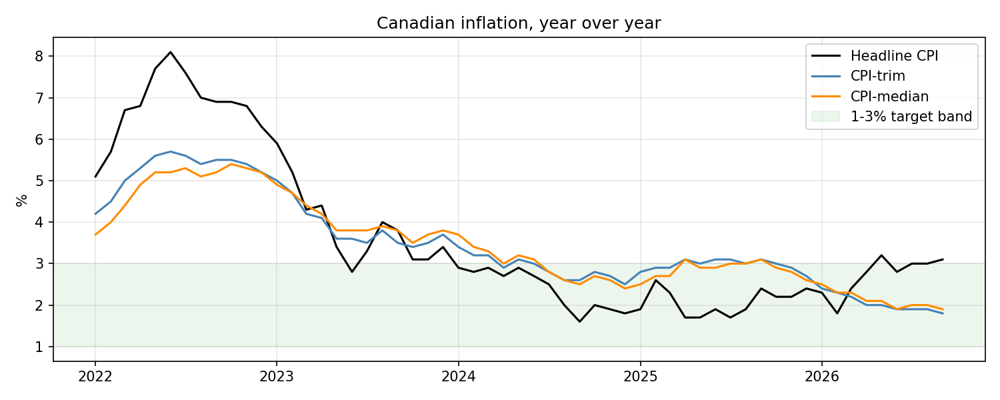

# Canada Rates Recap: The Bank of Canada's First Hike Since 2023

**Aylin Yasgul | November 5, 2026 | Data: Bank of Canada, to November 4, 2026**

**Summary.** The Bank of Canada raised its policy rate to 2.50% on October 28, its first hike since
July 2023. The 2-year yield had already risen about 80bp over the past year and is still about 70bp
above the new policy rate. Headline inflation is 3.1%, but the Bank's core measures are close to 2%.
The Bank hiked on where it expects inflation to go: it sees high oil prices spreading into other prices.

## The cycle

The Bank hiked from 0.25% to 5.00% between March 2022 and July 2023, then cut nine times to 2.25%
by October 2025. The hikes inverted the curve: 2s10s (the 10-year yield minus the 2-year yield)
reached -132bp in June 2023. It turned positive again in September 2024, once the cuts had started.

  

## The past year

Since November 4, 2025, the 2-year yield has risen from 2.43% to 3.22% and the 10-year from 3.15%
to 3.70%. Because the 2-year rose more, the curve flattened and 2s10s fell from 72bp to 48bp. Most of the 2-year's rise came
before the decision, and on October 21 it was 107bp above the policy rate. It rose about 5bp on decision
day and has fallen about 20bp since. Over the last month the 10-year fell about 23bp while the 2-year
barely moved, so the recent flattening came from the long end.

## Inflation

Headline CPI was 3.1% in September, just above the 1-3% target band. CPI-trim was 1.8% and
CPI-median 1.9%, both lower than at the start of the year.

  

## Why the Bank hiked with core inflation below 2%

In its October 28 statement the Bank said high oil prices are raising production and transport costs,
and its surveys suggest businesses will pass more of those costs on over the next year. It expects CPI
to reach about 3½% by the end of 2026 and to average 3% in 2027. It hiked to reduce the risk that energy
prices spread into other prices, and said further hikes could be needed but it would proceed carefully.

## Monitor, November 4, 2026

| | |
|---|---|
| Policy rate | 2.50% |
| 2-year / 10-year yield | 3.22% / 3.70% |
| 2s10s | 48bp |
| 2-year minus policy rate | 72bp |
| Headline CPI / CPI-trim / CPI-median (September) | 3.1% / 1.8% / 1.9% |

## What to watch

- **Core inflation.** The Bank's case rests on energy costs spreading. If CPI-trim and CPI-median
  start moving up toward headline, the case for more hikes gets stronger. The next decision is December 9.
- **The 2-year against the policy rate.** The 72bp gap means the market expects the policy rate to
  average about 3.2% over two years, so more hikes. It is only a rough guide, because the 2-year also
  includes a term premium. CORRA futures or overnight index swaps measure this more directly.
- **US yields.** The 10-year often follows US Treasuries, which can move the curve for reasons
  unrelated to the Bank of Canada.

The full analysis, which updates when rerun, is in [`curve_analysis.ipynb`](curve_analysis.ipynb).
